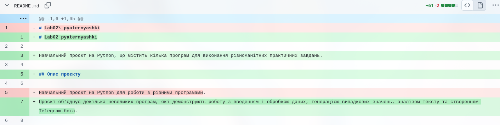

# Звіт до лабораторної роботи №2

## 1. Загальна інформація

- **ПІБ:** Ілля Засєкін
- **Група:** ІПЗ-22
- **GitHub:** https://github.com/NikanoNino
- **Роль у команді:** Розробник
- **Репозиторій:** https://github.com/awaikoi/Lab02_pyaternyashki.git

## 2. Особистий внесок

### Створені гілки
- [wordCounter](https://github.com/awaikoi/Lab02_pyaternyashki/tree/wordCounter) — гілка для word_counter.py.

### Pull Requests
- https://github.com/awaikoi/Lab02_pyaternyashki/pull/6

### Коміти
- https://github.com/awaikoi/Lab02_pyaternyashki/commit/7e07416e5ed44fe0719caacbb0089ca4f304bb8e
- https://github.com/awaikoi/Lab02_pyaternyashki/commit/e29fdd3211fdd0c61a10530ec2c1c0f3e348b933

## 3. Вирішення конфлікту злиття

Під час спільної роботи над файлом `README.md` виник конфлікт злиття, оскільки учасники команди внесли різні зміни до одного й того самого рядка.

Для вирішення конфлікту було переглянуто обидва варіанти змін, обрано узгоджений варіант і видалено службові маркери конфлікту. Після цього зміни було збережено та злито до основної гілки.

**Скріншот вирішення конфлікту:**

## 4. Додаткові завдання (рівень 3)

- **Створені Issues:** 
- **Реліз `v1.0.0`:** https://github.com/awaikoi/Lab02_pyaternyashki/releases/tag/v1.0.0

## 5. Висновки

Під час виконання лабораторної роботи я отримав практичні навички роботи з Git та GitHub, зокрема створення гілок, комітів і Pull Requests. Також я навчився вирішувати конфлікти злиття та організовувати спільну роботу над проєктом.

